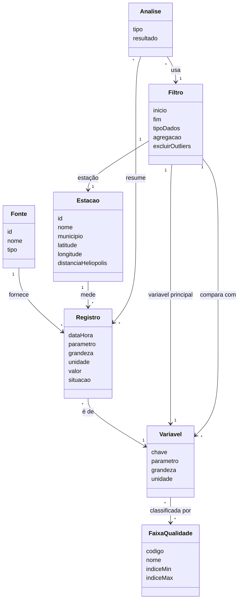
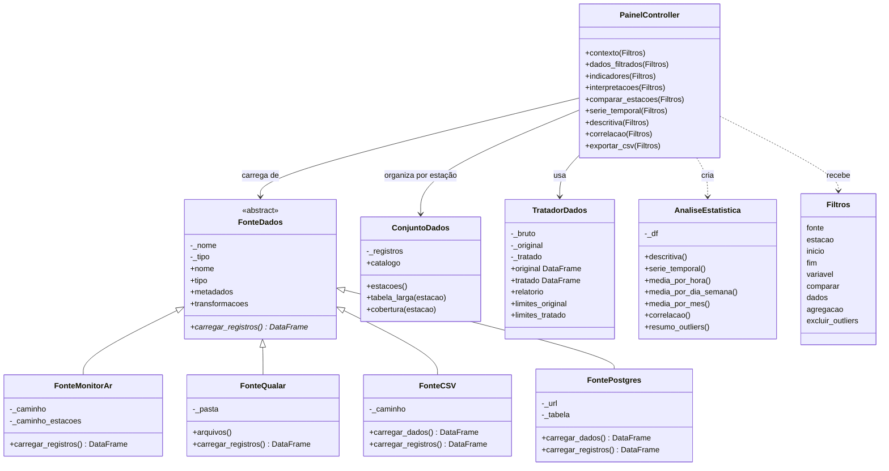
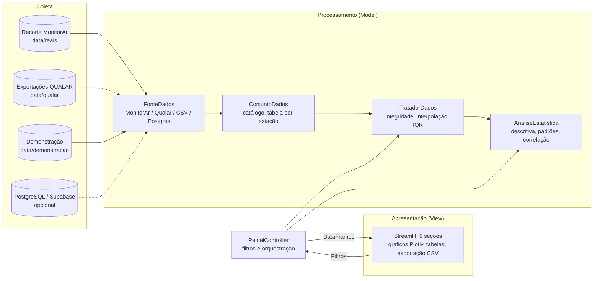

# Requisitos e arquitetura

Documento de apoio da PAE **Dados que Transformam: Inteligência Climática para Heliópolis** (atualizado para a **V2**).

**Legenda de origem**

| Marca | Significa |
|---|---|
| **[Aulas]** | vem diretamente dos slides (`Aulas-PAE.pdf`) |
| **[Enunciado]** | vem do pedido do projeto (funcionalidades, arquitetura, regras) |
| **[Código]** | já existia no `app.py` original |
| **[V2]** | vem do pedido de atualização da V2 (dados reais, código comentado, interface educativa) |
| **[Proposta]** | decisão tomada nesta implementação, não exigida pelos materiais |

Os materiais não trazem critérios de avaliação nem lista oficial de requisitos do sistema. Os requisitos abaixo
foram **propostos** por quem implementou, a partir do enunciado e do código original. Os exemplos dos slides
(plataforma de vídeo, "registrar temperatura a cada 5 minutos", etc.) ilustram o *formato* de um requisito e não
foram tratados como exigências.

## 1. Requisitos funcionais propostos

| ID | O sistema deve… | Origem |
|---|---|---|
| RF01 | Importar dados de várias fontes: recorte oficial do MonitorAr, exportações do QUALAR, CSV de demonstração e PostgreSQL | [Código] [Enunciado] [V2] |
| RF02 | Verificar a integridade dos dados (linhas, período, duplicatas, horas faltantes, maior lacuna, negativos, MP2.5 > MP10 quando houver as duas concentrações) | [Enunciado] [Proposta: itens específicos] |
| RF03 | Detectar valores ausentes e tratá-los, preservando os dados originais | [Código] [Enunciado] [Aulas: `fillna`] |
| RF04 | Oferecer uma versão "tratada" com interpolação temporal só em lacunas de até 4 h; a versão original (sem preenchimento) é o padrão | [Proposta] [V2: evitar preenchimento automático] |
| RF05 | Sinalizar outliers pelo método do IQR em todas as variáveis, sem removê-los | [Código: IQR] [Enunciado] [Aulas: IQR] [Proposta: sinalizar todas] |
| RF06 | Permitir excluir os outliers sinalizados das análises (opcional, desligado por padrão) | [Proposta] |
| RF07 | Calcular média, mediana, moda, mínimo, máximo, desvio padrão e variância | [Enunciado] [Aulas] |
| RF08 | Exibir indicadores com nome completo, sigla, valor e unidade, explicação, origem, período e interpretação oficial (faixas) | [Enunciado] [V2] |
| RF09 | Exibir a evolução temporal de qualquer indicador disponível na fonte e na estação escolhidas | [Enunciado] [V2] |
| RF10 | Exibir médias por hora do dia e por dia da semana | [Código] [Enunciado] |
| RF11 | Exibir histogramas, boxplots, gráficos de dispersão e heatmap de correlação | [Código: heatmap] [Enunciado] [Aulas] |
| RF12 | Permitir selecionar o período de análise | [Enunciado] |
| RF13 | Permitir selecionar a variável e compará-la com outras | [Enunciado] |
| RF14 | Permitir alternar entre dados originais e tratados e comparar os resultados | [Enunciado] |
| RF15 | Exibir tabelas detalhadas dos dados filtrados | [Enunciado] |
| RF16 | Exportar os resultados filtrados em CSV | [Enunciado] [Aulas: exemplo "exportar em CSV"] |
| RF17 | Explicar em linguagem simples média × mediana, outlier, correlação e material particulado, sem afirmar causalidade | [Enunciado] |
| RF18 | Mostrar em todas as páginas a fonte, a estação, o município, a distância até Heliópolis, o tipo de local (estação próxima ou fictício) e as datas | [Código] [Enunciado] [V2] |
| RF19 | Ler os dados de um PostgreSQL/Supabase quando configurado, voltando ao CSV se falhar | [Aulas: Supabase] [Enunciado: opcional] |
| RF20 | Agrupar as séries por hora, dia, semana ou mês | [Proposta] |
| RF21 | Escolher a estação e comparar o mesmo indicador entre estações, sem misturá-las | [V2] |
| RF22 | Classificar o índice nas faixas oficiais N1–N5 e concentrações só com unidade confirmada e no período de média oficial | [V2] |
| RF23 | Gerar interpretações automáticas a partir dos dados, sem afirmar causas | [V2] |
| RF24 | Oferecer glossário, tutorial, perguntas frequentes e "Como interpretar" em cada gráfico | [V2] |
| RF25 | Registrar e exibir todas as transformações aplicadas aos dados brutos | [V2] |
| RF26 | Mostrar como ausentes os dados que a fonte não traz, sem inventá-los | [V2] |

## 2. Requisitos não funcionais propostos

| ID | Requisito | Origem |
|---|---|---|
| RNF01 | Executar localmente, sem internet depois de instalado, sem APIs pagas ou credenciais | [Enunciado] [V2] |
| RNF02 | Credenciais de banco apenas por variáveis de ambiente, nunca no código | [Enunciado] |
| RNF03 | Separar Model, Controller e View; a View não acessa o Model diretamente | [Aulas] [Enunciado] |
| RNF04 | Interface em português do Brasil, com layout responsivo dentro das possibilidades do Streamlit | [Enunciado] [Aulas: exemplo "funcionar em celular e computador"] |
| RNF05 | Títulos, eixos e unidades coerentes em todos os gráficos (catálogo de parâmetros em `models/parametros.py`) | [Enunciado] |
| RNF06 | Os filtros atualizam gráficos, indicadores e tabelas de modo consistente | [Enunciado] |
| RNF07 | Não remover automaticamente valores extremos | [Enunciado] |
| RNF08 | Funcionar sem erro com ausentes, períodos sem registros e variáveis sem dados | [Enunciado] |
| RNF09 | Cobertura de testes automatizados dos cálculos, filtros e páginas | [Enunciado] [Proposta: pytest] |
| RNF10 | Cores com identidade estável por variável e paleta validada para daltonismo | [Proposta] |
| RNF11 | Carregar e tratar os dados uma única vez por sessão do servidor (cache) | [Proposta] |
| RNF12 | Código comentado em português para iniciantes, com guia de manutenção | [V2] |
| RNF13 | Rastreabilidade: dados brutos preservados, SHA-256 dos arquivos oficiais e metadados de download | [V2] |
| RNF14 | Não acrescentar dependências obrigatórias além de Streamlit, Pandas, NumPy e Plotly | [V2] |

## 3. Diagrama de classes de análise

Segundo as aulas, o diagrama de **análise** mostra a visão de negócio: classes, atributos e relacionamentos,
**sem métodos, herança ou implementação** (isso fica para o código, na seção 3.2).



*Origem:* `Fonte` e `Registro` correspondem às tabelas `fontes` e `registros_climaticos` das aulas. Na V2, o
registro passou a ser "um valor de um parâmetro numa hora numa estação" (formato longo), porque as fontes reais
trazem conjuntos de parâmetros diferentes. `Estacao` e `FaixaQualidade` são **[V2]**. `Analise` corresponde à tabela `analises` das
aulas e, nesta versão, é apenas conceito: os resultados são calculados na hora e **não são persistidos**.
`Variavel` e `Filtro` são **[Proposta]**.

### 3.2 Classes de projeto (código)

Aqui, sim, aparecem métodos e herança, aplicando o "do diagrama de classes ao código" das aulas.



As páginas da View (`views/pagina_*.py`) são funções `renderizar(ctrl, filtros)`: não se criou uma classe para
cada uma porque não haveria estado nem comportamento a encapsular.

## 4. Arquitetura lógica

As aulas descrevem três camadas: **coleta → processamento → apresentação** (exemplo: dataset importado →
tratamento no Pandas → análise → dashboard exibe). Esta é a instanciação para o projeto, com o MVC sobreposto:



Fluxo de uma interação (conforme "Fluxo de Dados no MVC" das aulas): o usuário muda um filtro na **View** → a View
monta um objeto `Filtros` e chama o **Controller** → o Controller consulta o **Model** (Tratador e Análise) → o
Model devolve DataFrames → a View desenha os gráficos.

## 5. Como os conceitos das aulas foram aplicados

| Conceito (aulas) | Onde aparece no projeto |
|---|---|
| Planejar antes de codar; requisitos | Este documento (RF/RNF) |
| Requisito funcional × não funcional | Seções 1 e 2 (verbo de ação × qualidade/restrição) |
| Diagrama de classes de análise | Seção 3 |
| Arquitetura lógica em camadas | Seção 4 |
| Média, mediana, moda | `AnaliseEstatistica.descritiva`; histograma com linhas de média e mediana |
| Desvio padrão e variância | `descritiva`; Ajuda → Glossário |
| Distribuição e histograma | Análise estatística → *Distribuição* |
| Correlação (−1 a +1) | Análise estatística → *Correlações*; Comparação → dispersão |
| Outliers: IQR e boxplot | `limites_iqr`, abas *Boxplot* e *Outliers* da Análise estatística |
| Scatterplot e heatmap | Comparação de indicadores e aba *Correlações* |
| "Estatística é o conceito; Pandas é a ferramenta" | `.mean()`, `.median()`, `.corr()`, `groupby`, `resample` no Model |
| POO: classe e objeto | `Variavel`, `Parametro`, `ConjuntoDados`, `Filtros`, `TratadorDados`, `AnaliseEstatistica`, `PainelController` |
| Encapsulamento | Atributos privados e propriedades em `FonteDados` e `TratadorDados` (devolvem cópias; há teste) |
| Herança | `FonteMonitorAr`, `FonteQualar`, `FonteCSV` e `FontePostgres` herdam de `FonteDados` |
| Polimorfismo | `carregar_registros()` implementado de forma diferente em cada fonte; o Controller usa só o contrato |
| Do diagrama de classes ao código | Seções 3 e 3.2 |
| MVC (Model, View, Controller) | Pastas `models/`, `controllers/`, `views/` + `app.py` |
| "A View chama o Controller, nunca fala direto com o Model" | As páginas só importam o Controller; o catálogo de variáveis chega por `ctrl.catalogo` e `ctrl.variaveis` |
| "Se o Model mudar (Supabase por CSV), a View nem percebe" | `PainelController.a_partir_da_configuracao` escolhe a fonte; teste de *fallback* |
| Banco relacional (tabela, chaves) | `docs/schema.sql` (`fontes` 1—N `registros_ambientais`, PK e FK) |
| SQL básico (SELECT, WHERE) | Consulta em `FontePostgres`; exemplos em `schema.sql` |
| Python ↔ PostgreSQL (SQLAlchemy/psycopg2) | `FontePostgres` e `scripts/carregar_csv_no_banco.py` |
| Pandas: `fillna`, `groupby`, `read_sql` | Interpolação (variante de tratamento de ausentes), `groupby`, `pd.read_sql` |
| Supabase | Aceito via `DATABASE_URL`; não obrigatório |

**Não aplicado, por decisão:** o bloco bônus de IA e regressão linear (o enunciado exclui IA preditiva nesta
versão) e a consulta a APIs externas como INMET/CPTEC (citadas como exemplo de coleta nas aulas; o enunciado pede
funcionamento sem serviços externos). Na V2, os dados reais vêm de **arquivos oficiais baixados uma vez** e
guardados no projeto, e não de uma API consultada em tempo real.

## 6. Decisões e pontos em aberto

| Tema | Decisão | Status |
|---|---|---|
| Imputação | Interpolação temporal, lacunas de até 4 h, só na versão "tratada"; padrão = original | Confirmada pelo usuário; padrão alterado na V2 |
| Unidade da temperatura | °C (dados do Brasil) | Confirmada pelo usuário |
| Unidades dos poluentes (demonstração) | µg/m³ e ppm **assumidas**, marcadas como não confirmadas; sem classificação oficial | **Em aberto** para o CSV fictício |
| Dados reais | MonitorAr 2024–2025, 6 estações a 6,7–9,8 km; só índice IQAr, um poluente por hora | V2 (ver `FONTES_DE_DADOS.md`) |
| IQAr da estação | Maior índice da hora entre os poluentes | V2, Proposta (regra CETESB) |
| Correlação nos dados reais | Não calculada: um poluente por hora | V2 |
| Banco de dados | Leitura opcional de PostgreSQL com *fallback* para CSV e script de carga | Confirmada pelo usuário |
| Moda e variância | Incluídas (citadas nas aulas) | Confirmada pelo usuário |
| Outliers | IQR global sobre o conjunto completo; sinalizar em vez de remover | Proposta |
| MP2.5 > MP10 (19 registros na demonstração) | Apenas alertar; não corrigir | Proposta |
| Correlação temperatura × umidade (demonstração) | O app mostra o que o dado indica (+0,23); não reproduz o "geralmente negativa" do slide | Proposta |
| Estrutura de pastas | `models/ controllers/ views/ services/` do enunciado, em vez dos 3 arquivos dos slides | Proposta (a estrutura de 3 arquivos dos slides é um exemplo mínimo) |
| Critérios de avaliação da PAE | Não constam nos materiais; nada foi presumido | Em aberto |

---

## 7. Atualização da V4

### 7.1 Novos requisitos funcionais

| Código | Requisito | Onde |
|---|---|---|
| RF-V4-01 | Mostrar temperatura e umidade dos termômetros da UNAS (um ou vários; média, mínima, máxima; evolução; comparação; períodos; tabela; exportação). | `views/pagina_termometros.py` |
| RF-V4-02 | Comparar termômetros no período em que todos mediram juntos. | `models/termometros.py` (`periodo_comum`) |
| RF-V4-03 | Mapa com recorte, quebradas, glebas, projetos da UNAS e estações; seleção de quebrada. | `views/pagina_mapa.py` |
| RF-V4-04 | Nunca expor nome, endereço ou ponto exato de residências. | `scripts/preparar_dados_termometros.py`, `controllers/mapa_controller.py` |
| RF-V4-05 | Navegação por assunto (7 páginas) e filtros só onde são usados (feedback UNAS). | `app.py`, `app_pages/` |
| RF-V4-06 | Executável para Windows sem Python. | `executavel/` |

### 7.2 Arquitetura atualizada

```text
app.py ─ st.navigation ─► app_pages/<página>.py ─► views/pagina_*.py
                                                     │
                     views/sessao.py (obter_sistema) │
                                                     ▼
controllers/sistema.py ─► PainelController (ar) · TermometrosController · MapaController
                                │                       │                     │
models/  fontes, conjunto, ...  ┘        termometros.py ┘        geografia.py ┘
                                                     │
data/  reais/ · termometros/ (anônimo) · geo/ (GeoJSON) · demonstracao/
```

Novas classes: `DadosTermometros`, `AnaliseTermometros`, `Termometro` (Model); `CamadasGeograficas` (Model);
`TermometrosController`, `FiltrosTermometros`, `MapaController`, `Sistema` (Controller).
